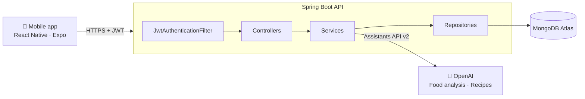

<p align="center">
  
</p>

<h1 align="center">CalorIA — Backend API</h1>

<p align="center">
  REST API for <b>CalorIA</b>, an AI-powered nutrition coaching mobile app.<br/>
  Built with Java 17, Spring Boot 3, Spring Security (JWT), MongoDB Atlas and the OpenAI Assistants API.
</p>

<p align="center">
  
  
  
  
  
  
</p>

---

## Overview

CalorIA helps users reach their body-composition goals. Users sign up and complete a short onboarding (body data, activity level, goal, food preferences and allergies). The API then:

- **Calculates personalised calorie and macronutrient targets** from the user's profile.
- **Analyses meals** written as free text ("chicken breast, 150 g") and returns protein, carbs, fat and calories, using an AI assistant.
- **Tracks daily intake** against those targets.
- **Generates recipes with AI**, fitted to the macros the user has left for the day and respecting their preferences and allergies.

This repository contains the backend. The mobile client (React Native / Expo) lives at **[briansittmann/CalorIA_SDK53](https://github.com/briansittmann/CalorIA_SDK53)**.

## Architecture



It uses a classic layered design (`controller → service → repository`), with DTOs at the API boundary and a stateless JWT filter in front of every protected route.

## Key features

### 🔐 Stateless authentication
- Spring Security with a custom `OncePerRequestFilter` that validates `Authorization: Bearer <token>` on every request.
- Tokens are signed with HS256 (JJWT), carry the user ID as the subject and expire after 24 hours.
- Passwords are hashed with **BCrypt**.
- Login credentials (`credenciales`) are stored apart from profile data (`usuarios`).

### 🧮 Calorie and macro calculation
- **BMR** uses the **Mifflin-St Jeor** equation.
- **TDEE = BMR × activity factor**, with six levels from 1.20 (sedentary) to 2.20 (extreme).
- **Calorie target = TDEE × goal factor**, with seven goals from an aggressive cut (−25 %) to an aggressive bulk (+15 %).
- **Macro split:** 30 % protein, 25 % fat, 45 % carbohydrates. Values are rounded with `BigDecimal`.
- **User-defined "nutritional day":** each user sets the hour their day starts, so a late-night meal counts toward the right day.

### 🤖 AI meal analysis, with a self-growing food catalog
1. The client sends a list of `{ name, grams }` items.
2. Foods already in the MongoDB **food catalog** are calculated locally from their per-100 g values.
3. Only unknown foods are sent to an **OpenAI Assistant**, in one batched prompt.
4. The results are normalised per 100 g and **saved back to the catalog**. The catalog works as a cache, so the API makes fewer AI calls (and pays less) the more it is used.
5. Saving to the catalog and updating the day's totals happen asynchronously (`CompletableFuture`), which keeps responses fast.

### 🍽️ AI recipe generation
- A second assistant gets the user's **remaining macros for the day**, their preferences and their allergies.
- It returns 1–N structured recipes: ingredients with grams, instructions and macros.
- Recipes are deduplicated by title, saved to a shared catalog and can be added to the user's personal list.

### 🧭 Step-by-step onboarding
- The profile is completed in four independent steps: basics, activity, goal, preferences.
- Endpoints report completion status per step, so the client can resume onboarding where the user left off.
- Targets can be recalculated at any time after the profile changes.

### 📖 API documentation
- Interactive **Swagger UI** via springdoc-openapi.
- Bean Validation on request DTOs (`@Valid`, `@Email`, `@NotBlank`, `@Min`/`@Max`).

## Tech stack

| Layer | Technology |
|---|---|
| Language / runtime | Java 17 |
| Framework | Spring Boot 3.3 (Web, Data MongoDB, Security, Validation) |
| Auth | Spring Security, JJWT 0.11 (HS256), BCrypt |
| Database | MongoDB Atlas |
| AI | OpenAI Assistants API v2 (Java client + custom OkHttp configuration) |
| Docs | springdoc-openapi 2.5 (Swagger UI) |
| Tooling | Maven Wrapper, Lombok |

## API reference

All routes except `/auth/**` and the Swagger docs require a valid JWT. The full, interactive specification is available in Swagger UI once the app is running.

| Method | Endpoint | Description |
|---|---|---|
| `POST` | `/auth/register` | Create an account and return a JWT |
| `POST` | `/auth/login` | Authenticate and return a JWT |
| `POST` | `/usuarios/perfil/basicos` | Onboarding step 1: name, age, sex, height, weight, day start time |
| `POST` | `/usuarios/perfil/actividad` | Onboarding step 2: activity level |
| `POST` | `/usuarios/perfil/objetivo` | Onboarding step 3: goal (calculates targets) |
| `PUT` | `/usuarios/perfil/preferencias` | Onboarding step 4: food preferences and allergies |
| `GET` | `/usuarios/perfil` | Get the full user profile |
| `PUT` | `/usuarios/perfil` | Update the full profile |
| `GET` | `/usuarios/perfil/estado` | Completion status of each onboarding step |
| `GET` | `/usuarios/perfil/completo` | Whether the profile is complete |
| `PUT` | `/usuarios/perfil/recalcular-metas` | Recalculate calorie and macro targets |
| `POST` | `/comida/analizar` | Analyse a list of foods and add them to today's intake |
| `POST` | `/comida/importar-catalogo` | Bulk-import foods into the catalog |
| `GET` | `/dia/resumen` | Today's summary: targets, consumed and remaining |
| `POST` | `/recetas/generar?numComidas=N` | Generate N AI recipes for the remaining macros |
| `POST` | `/recetas/guardar` | Save recipes to the user's list |
| `GET` | `/recetas/mis` | List the user's saved recipes |
| `DELETE` | `/recetas/{recetaId}` | Remove a recipe from the user's list |

<details>
<summary><b>Example: analyse a meal</b></summary>

```http
POST /comida/analizar
Authorization: Bearer <token>
Content-Type: application/json

[
  { "nombre": "pechuga de pollo", "gramos": 150 },
  { "nombre": "arroz blanco", "gramos": 100 }
]
```

The response contains protein, carbohydrates, fat and calories for each food. The totals are added to the user's current day.
</details>

## Getting started

### Prerequisites
- Java 17+
- A MongoDB instance (Atlas or local)
- An OpenAI API key and two Assistants (one for food analysis, one for recipes)

### Environment variables

| Variable | Description |
|---|---|
| `MONGODB_URI` | MongoDB connection string |
| `JWT_SECRET` | HMAC secret for signing tokens (at least 32 characters) |
| `OPENAI_API_KEY` | OpenAI API key |
| `FOOD_AI` | Assistant ID used for food and macro analysis |
| `RECIPES_AI` | Assistant ID used for recipe generation |

### Run locally

```bash
git clone https://github.com/briansittmann/caloria-backend.git
cd caloria-backend

export MONGODB_URI="mongodb+srv://..."
export JWT_SECRET="a-long-random-secret-of-at-least-32-chars"
export OPENAI_API_KEY="sk-..."
export FOOD_AI="asst_..."
export RECIPES_AI="asst_..."

./mvnw spring-boot:run
```

The API starts on **http://localhost:8080**.
Swagger UI: **http://localhost:8080/swagger-ui/index.html**

## Project structure

```
src/main/java/com/caloria/
├── config/       # Security, JWT filter, Swagger, Jackson, OkHttp (OpenAI) configuration
├── controller/   # REST controllers: auth, profile, food, day, recipes
├── dto/          # Request / response DTOs with Bean Validation
├── model/        # MongoDB documents and enums (activity level, nutritional goal)
├── repository/   # Spring Data MongoDB repositories
├── service/      # Business logic: metabolism, AI integration, JWT, day tracking
└── utils/        # BigDecimal rounding helpers
```

> **Note:** CalorIA was built for a Spanish-speaking audience, so domain names in the code and API (`comida`, `receta`, `objetivo`…) are in Spanish.

## Roadmap

- [ ] Unit and integration tests (JUnit 5, Mockito, Testcontainers)
- [ ] Global exception handler (`@ControllerAdvice`) with consistent error responses
- [ ] Docker image and a CI pipeline (GitHub Actions)
- [ ] Refresh tokens
- [ ] Per-meal history endpoint

## Author

**Brian Sittmann**: Junior Java Backend Developer
[GitHub](https://github.com/briansittmann) · [Portfolio](https://briansittmann.dev)
